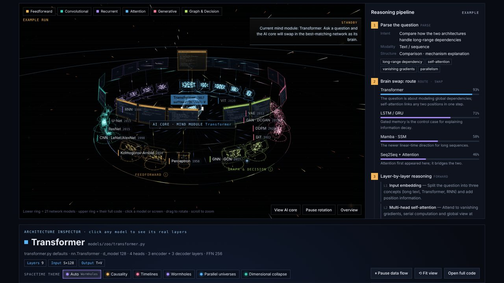
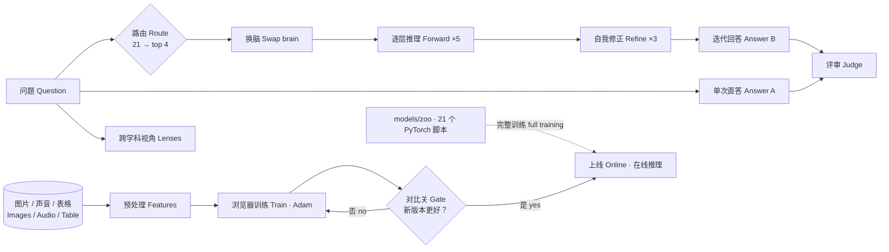

# Neural Atlas · 神经图谱

A 3D atlas of 21 neural-network architectures. An AI core in the centre picks the network whose structure best fits your question, swaps it in as its "brain", reasons layer by layer and compares that answer with a single-pass one. Every model is backed by a runnable PyTorch script, and a data bay lets you train, compare and deploy small models on your own images, audio or tables, right in the browser.

21 种神经网络架构的 3D 图谱。中央的 AI 核心按问题挑出结构最匹配的网络"换脑"，逐层推理，再和单次直答对比。每个模型都有可运行的 PyTorch 脚本；数据舱可以载入你自己的图片、声音或表格，在浏览器里训练、对比、上线。

Bản đồ 3D của 21 kiến trúc mạng nơ-ron. Lõi AI ở trung tâm chọn mạng có cấu trúc phù hợp nhất với câu hỏi, "thay não", suy luận theo từng lớp rồi so sánh với câu trả lời một lượt. Mỗi mô hình đều có script PyTorch chạy được; khoang dữ liệu cho phép huấn luyện, so sánh và triển khai mô hình nhỏ trên ảnh, âm thanh hoặc bảng của bạn ngay trong trình duyệt.

**Live page / 在线页面 / Trang trực tuyến:** https://tianmingliu-pixel.github.io/neural-atlas/



- [中文](#中文)
- [English](#english)
- [Tiếng Việt](#tiếng-việt)



---

## 中文

### 功能

| 模块 | 说明 |
|---|---|
| 3D 主舞台 | 21 个模型按 6 大家族排成一圈，上层是各自的代码屏，中心是 AI 核心；点家族名弹出半透明 wiki 卡片 |
| 换脑推理 | 路由 → 换脑 → 逐层推理 ×5 → 自我修正 ×3 → 条件生成 → 评审；3D 动画的每一步都来自路由返回的 JSON |
| 单次 vs 迭代 | 两份回答并排，真实计时（首字延迟、总耗时、字数）和评审打分 |
| 跨学科视角 | 公式、2D 物理模拟、颜色学热图（空白期 / 磨合区 / 用力点，可对照基线）、机制图 |
| 结构透视 | 按脚本默认参数画出真实层形状；5 种时空主题（因果律、时间线、虫洞、平行宇宙、降维）各自对应模型的数学 |
| 代码目录 | 21 个脚本 + 公共模块的完整源码，右侧是总代码结构 |
| 数据舱 | 图片文件夹（子文件夹=类别）、声音、表格（CSV / JSON / XLSX）；看到每一步预处理；感知机或 MLP 在浏览器里用 Adam 训练，实时曲线、混淆矩阵 |
| 对比 → 上线 | 新版本的验证分数必须超过线上版本才能上线；版本历史、在线推理、导出模型 JSON 和特征 CSV |
| 三种语言模式 | 中文 / EN / 中英，界面、3D 标签、提示词和模型输出都跟着切换 |

### 静态网页版能用什么

GitHub Pages 上的页面是纯静态的，**没有任何密钥**：

- 可以直接用：3D 图谱、「播放示例」完整流程、结构透视、代码目录、wiki、数据舱训练 / 上线 / 在线推理 / 导出。
- 实时提问需要语言模型：在 Claude 里打开本页时会用你自己的 Claude 额度（每个问题 5 次调用）。静态版会显示提示，并把「开始推理」按钮置灰。

### 部署到 GitHub Pages

仓库 Settings → Pages → Build and deployment → Source 选 **Deploy from a branch**，分支选 `main`、目录 `/ (root)`，保存。约一分钟后页面就在 `https://<用户名>.github.io/neural-atlas/`。`.nojekyll` 已包含，不需要构建步骤。

### 本地运行

```bash
# 直接双击 index.html 也可以；或者起一个本地服务器：
python -m http.server 8080
# 浏览器打开 http://127.0.0.1:8080
```

### PyTorch 模型库

```bash
pip install -r models/requirements.txt
pip install -r models/zoo/requirements-zoo.txt
python models/zoo/cnn.py train --dataset digits --arch lenet
python models/zoo/vit.py train --data path/to/images   # 每个类别一个子文件夹
python models/run_selftests.py                          # 全部自检
```

每个脚本都支持 `train` / `predict` / `selftest`。AMD 显卡（Windows）请先装 `torch-directml`，见 `models/requirements.txt` 顶部说明。

### 目录结构

```
index.html                 整个网页（three.js、所有功能、内嵌 21 个脚本源码）
models/                    PyTorch 训练脚本（common.py、表格 / 影像 / 日志 / 代码任务）
models/zoo/                其余 zoo 模型（cnn、vit、gpt、gnn、dqn …）
docs/img/                  README 用的截图
docs/Neural-Atlas-Presentation.pdf   课程展示幻灯片
tests/smoke_test.py        无头浏览器冒烟测试
```

### 测试

```bash
pip install playwright && python -m playwright install chromium
python tests/smoke_test.py
```

### 已知局限

- 浏览器训练用的是手工特征 + 小网络，不是真正的卷积；真正的 CNN / ViT 训练请用 `models/zoo`。
- 「换脑」是把网络结构当作语言模型的推理模板，不是直接用 CNN 处理问题。
- 时空主题是科幻比喻，层形状和数据流仍是模型的真实结构。

---

## English

### Features

| Module | What it does |
|---|---|
| 3D main stage | 21 models in 6 families on one ring, each with its code screen above; the AI core in the centre; click a family name for a glass wiki card |
| Brain-swap reasoning | Route → swap → forward ×5 → refine ×3 → conditioned answer → judge; every animation step comes from the routing call's JSON |
| Single pass vs iterated | Both answers side by side with live timings (first token, total, length) and judge scores |
| Cross-domain lenses | Formulas, a 2D physics sandbox, a colour-science heat map (blank period / friction zone / force point, vs a baseline), a mechanism graph |
| Architecture inspector | Real layer shapes from each script's defaults; 5 spacetime themes (causality, timelines, wormholes, parallel universes, dimensional collapse), each tied to the model's math |
| Code catalog | Full source of the 21 scripts and shared modules, with an overall code-structure panel |
| Data bay | Image folder (sub-folder = class), audio, tables (CSV / JSON / XLSX); every preprocessing step is visible; a perceptron or MLP trains in the browser with Adam, live curves, confusion matrix |
| Compare → deploy | A candidate goes online only if its validation score beats the online version; version history, online inference, model JSON and features CSV export |
| Three language modes | Chinese / English / both — UI, 3D labels, prompts and model output |

### What the static web version can do

The GitHub Pages site is fully static and **holds no keys**:

- Works as-is: the 3D atlas, the full "Play example" run, the inspector, code catalog, wiki, and data-bay training / deploy / online inference / export.
- Live questions need a language model: opened inside Claude, the page uses your own Claude usage (5 calls per question). The static version says so and disables the Run button.

### Deploy to GitHub Pages

In the repo go to Settings → Pages → Build and deployment → Source: **Deploy from a branch**, branch `main`, folder `/ (root)`, Save. About a minute later the site is at `https://<user>.github.io/neural-atlas/`. `.nojekyll` is included, so there is no build step.

### Run locally

```bash
# Opening index.html directly works too; or serve it:
python -m http.server 8080
# then open http://127.0.0.1:8080
```

### PyTorch model zoo

```bash
pip install -r models/requirements.txt
pip install -r models/zoo/requirements-zoo.txt
python models/zoo/cnn.py train --dataset digits --arch lenet
python models/zoo/vit.py train --data path/to/images   # one sub-folder per class
python models/run_selftests.py                          # run every self-test
```

Every script supports `train` / `predict` / `selftest`. On Windows with an AMD GPU, install `torch-directml` first (see the top of `models/requirements.txt`).

### Layout

```
index.html                 the whole site (three.js, every feature, all 21 scripts embedded as source)
models/                    PyTorch training scripts (common.py; tabular / image / log / code tasks)
models/zoo/                the other zoo models (cnn, vit, gpt, gnn, dqn …)
docs/img/                  screenshots for this README
docs/Neural-Atlas-Presentation.pdf   course presentation slides
tests/smoke_test.py        headless-browser smoke test
```

### Tests

```bash
pip install playwright && python -m playwright install chromium
python tests/smoke_test.py
```

### Known limits

- Browser training uses hand-made features and a small network, not real convolutions; use `models/zoo` for real CNN / ViT training.
- "Brain swap" uses a network's structure as a reasoning template for the language model; it does not run, say, a CNN on the question.
- Spacetime themes are sci-fi metaphors; layer shapes and data flow are the model's real structure.

---

## Tiếng Việt

### Tính năng

| Mô-đun | Chức năng |
|---|---|
| Sân khấu 3D | 21 mô hình thuộc 6 họ xếp trên một vòng, màn hình mã nguồn của từng mô hình ở phía trên, lõi AI ở trung tâm; bấm tên họ để mở thẻ wiki trong suốt |
| Suy luận "thay não" | Định tuyến → thay não → suy luận theo lớp ×5 → tự sửa ×3 → sinh câu trả lời có điều kiện → chấm điểm; mỗi bước hoạt ảnh 3D đều lấy từ JSON mà lời gọi định tuyến trả về |
| Một lượt vs lặp theo mạng | Hai câu trả lời đặt cạnh nhau, đo thời gian thực (token đầu, tổng thời gian, độ dài) và điểm chấm |
| Góc nhìn liên ngành | Công thức, mô phỏng vật lý 2D, bản đồ nhiệt theo khoa học màu sắc (giai đoạn trống / vùng ma sát / điểm dùng lực, so với môi trường tham chiếu), sơ đồ cơ chế |
| Soi kiến trúc | Vẽ đúng hình dạng các lớp theo tham số mặc định của script; 5 chủ đề không-thời gian (nhân quả, dòng thời gian, lỗ sâu, vũ trụ song song, giảm chiều), mỗi chủ đề gắn với toán học của mô hình |
| Danh mục mã | Toàn bộ mã nguồn của 21 script và các mô-đun dùng chung, kèm bảng cấu trúc mã tổng thể |
| Khoang dữ liệu | Thư mục ảnh (thư mục con = lớp), âm thanh, bảng (CSV / JSON / XLSX); thấy rõ từng bước tiền xử lý; perceptron hoặc MLP huấn luyện trong trình duyệt bằng Adam, đường cong trực tiếp, ma trận nhầm lẫn |
| So sánh → triển khai | Phiên bản mới chỉ được đưa lên khi điểm kiểm định cao hơn phiên bản đang chạy; lịch sử phiên bản, suy luận trực tuyến, xuất mô hình JSON và đặc trưng CSV |
| Ba chế độ ngôn ngữ | Giao diện: Trung / Anh / song ngữ — giao diện, nhãn 3D, prompt và đầu ra của mô hình đều chuyển theo |

### Phiên bản web tĩnh dùng được gì

Trang trên GitHub Pages là trang tĩnh và **không chứa bất kỳ khóa API nào**:

- Dùng ngay: bản đồ 3D, toàn bộ quy trình "Play example", soi kiến trúc, danh mục mã, wiki, và khoang dữ liệu (huấn luyện / triển khai / suy luận trực tuyến / xuất file).
- Hỏi trực tiếp cần mô hình ngôn ngữ: khi mở trang bên trong Claude, trang dùng hạn mức Claude của bạn (5 lời gọi cho mỗi câu hỏi). Bản tĩnh sẽ hiển thị thông báo và vô hiệu hóa nút Run.

### Triển khai lên GitHub Pages

Vào Settings → Pages → Build and deployment → Source: **Deploy from a branch**, nhánh `main`, thư mục `/ (root)`, bấm Save. Khoảng một phút sau trang sẽ có tại `https://<user>.github.io/neural-atlas/`. Đã có sẵn `.nojekyll`, không cần bước build.

### Chạy trên máy

```bash
# Mở trực tiếp index.html cũng được; hoặc chạy máy chủ cục bộ:
python -m http.server 8080
# rồi mở http://127.0.0.1:8080
```

### Kho mô hình PyTorch

```bash
pip install -r models/requirements.txt
pip install -r models/zoo/requirements-zoo.txt
python models/zoo/cnn.py train --dataset digits --arch lenet
python models/zoo/vit.py train --data path/to/images   # mỗi lớp một thư mục con
python models/run_selftests.py                          # chạy toàn bộ tự kiểm tra
```

Mỗi script đều hỗ trợ `train` / `predict` / `selftest`. Trên Windows với GPU AMD, hãy cài `torch-directml` trước (xem đầu file `models/requirements.txt`).

### Kiểm thử

```bash
pip install playwright && python -m playwright install chromium
python tests/smoke_test.py
```

### Giới hạn đã biết

- Huấn luyện trong trình duyệt dùng đặc trưng thủ công và mạng nhỏ, không phải tích chập thật; hãy dùng `models/zoo` để huấn luyện CNN / ViT thật.
- "Thay não" dùng cấu trúc của mạng làm khuôn suy luận cho mô hình ngôn ngữ; nó không chạy trực tiếp, ví dụ, một CNN lên câu hỏi.
- Các chủ đề không-thời gian là ẩn dụ khoa học viễn tưởng; hình dạng lớp và luồng dữ liệu vẫn là cấu trúc thật của mô hình.
